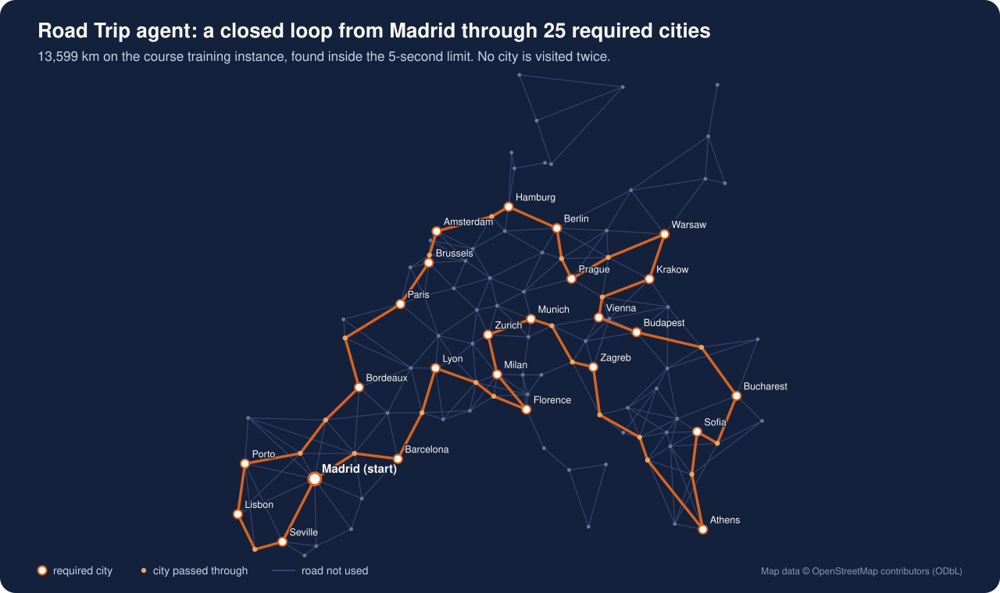

# AI Agent Tournament: four game-playing agents in Python

Four autonomous agents that each play a different game against another team's agents, under a 5-second clock and with no human at the keyboard: a route planner, a chess engine, a Battleship player that tracks hidden moving ships, and a Catan player.

This was a **group project of four** for the course *AI: Reasoning & Problem Solving* at IE University (November 2026). Each of us owned one agent. Claude Code was used to aid the development of the agents and to audit that development (details below). **My agent is the Road Trip one**; I also assembled the final submission folder and ran the final checks on it.



## The four agents

| Agent | The problem | Main techniques | Measured result | Owner |
|---|---|---|---|---|
| [Road Trip](agents/roadtrip_agent.py) | Shortest loop through 25 required cities on a 105-city road map, never passing through a city twice | A* search, cheapest insertion, simulated annealing (2-opt, Or-opt) | Beat the course's reference agent in 50 of 50 games, with routes 19% shorter on average | **Sanad (me)** |
| [Chess](agents/chess_agent.py) | Two games against a rival engine with 5 seconds of thinking time per game | Alpha-beta with iterative deepening, transposition table, quiescence search | About 1430 Elo (95% interval 1320 to 1540) against rating-limited Stockfish, on Stockfish's own scale rather than FIDE's | Raji |
| [Battleship](agents/battleship_agent.py) | Enemy ships are hidden and can move until they are first hit | Bayesian belief filter, constraint satisfaction, value of information for sonar | Win rate against a reference agent rose from 28% (baseline) to 97% | Serge |
| [Catan](agents/catan_agent.py) | Dice, hidden cards, and 5 seconds for the whole game | One-turn planner, inference of the rival's hand, Q-learning | Win rate against a reference agent rose from 37% (baseline) to 90% | Lorenzo |

The assembled team folder passes all 14 of the course judge's required-algorithm checks. In full test matches in the official judge it won all four games against the course's reference team `demo_a` on my laptop, and against both reference teams (`demo_a` and `demo_b`) on Google Colab, with no illegal move, crash or timeout.

All numbers on this page were measured by our team, in tests against the course's reference agents and against our own earlier versions. The full method, tables and limits for every agent are in the [technical report](docs/TECHNICAL_REPORT.md) we submitted.

## My part: the Road Trip agent

**The problem.** Start in Madrid, visit 25 required cities and return, on a real road map of 105 European cities and 262 roads. The route may not pass through any city twice, and the agent has 5 seconds. It is a travelling-salesman problem with an extra rule that makes it harder: a good route uses about 47 cities, so every stretch of road chosen early blocks cities that later stretches may need.

**How it works.**

1. **One search core.** Uniform-cost search and A* share a single best-first search. The straight-line (Haversine) distance never overestimates a road, so A* stays optimal while expanding fewer than half as many cities (184 against 392 on the judge's test pairs).
2. **A valid route first.** The first loop is built by cheapest insertion on the real map. Every new stretch is an A* path with the cities already on the route blocked, so the route is valid at every step. A first route is submitted within about 0.3 seconds, which means the agent always has an answer on the board.
3. **Then improve it.** Simulated annealing works on the real route with 2-opt, Or-opt and re-route moves. It accepts some longer routes early to escape local optima, and restarts from fresh builds.
4. **Built not to fail.** Sets of cities are bitmasks, so "does this path touch the route?" is one AND operation. The agent times its own first build and reduces its work on a slow machine. Everything after the first submission runs inside a guard, so an error can never remove a route that was already submitted.

**How it was tested.**

| Test | Result |
|---|---|
| Against the course's reference agent, official judge, 50 seeded games | 50 wins, 12,943 km against 16,050 km on average |
| Against the same code without the annealing step | 46 wins, 4 draws, 0 losses |
| Against exact optima from an integer-programming solver, used only for testing (in-process, with the judge's route checker) | Optimal in 83 to 84 of 84 runs on the 28 instances where the optimum is known; the one miss was 0.5% longer |
| 400 random instances (in-process, with the judge's route checker) | A valid route on all 400 |
| Time limit cut to a quarter, to imitate a slow machine (in-process, with the judge's route checker) | 200 of 200 valid routes, 7 km mean gap to the best known route |

**Limits.** It is a heuristic, so it cannot prove a route is optimal, and it misses the best route more often on a slower machine. The technical report covers this, along with what was tried and rejected.


## Repository layout

```
agents/
  roadtrip_agent.py      A* search, cheapest insertion, simulated annealing (my agent)
  chess_agent.py         alpha-beta search with iterative deepening
  battleship_agent.py    Bayesian belief filter and constraint satisfaction
  catan_agent.py         planner, opponent tracker and Q-learning
docs/
  TECHNICAL_REPORT.md    the report submitted with the project
  images/                the route map above
requirements.txt
```

Each agent is a single file, as the course required. They use the Python standard library plus `python-chess` (chess) and `numpy` (Battleship).

## Running the agents

The agents are players, not a full program: they plug into the course's tournament judge, which supplies the rules, the map and the clocks. The judge is course material and is not included here. From the course package folder (which has its own dependencies: `catanatron`, `networkx`, `psutil`), a full match is one line in the course notebook:

```python
TEAM_A = "agents"   # the folder with the four files
```

and a single game is `run_game("road_trip", "agents/roadtrip_agent.py", opponent="demo")`.

Each file can also be read on its own. The docstring at the top of `roadtrip_agent.py` walks through the whole method.

## Team

Road Trip: Sanad Hamad. Chess: Raji. Battleship: Serge. Catan: Lorenzo. The other three agents are my teammates' work.

This is coursework shared for reading. No licence is granted to reuse the code.

Road distances come from OpenStreetMap data (© OpenStreetMap contributors, ODbL).
